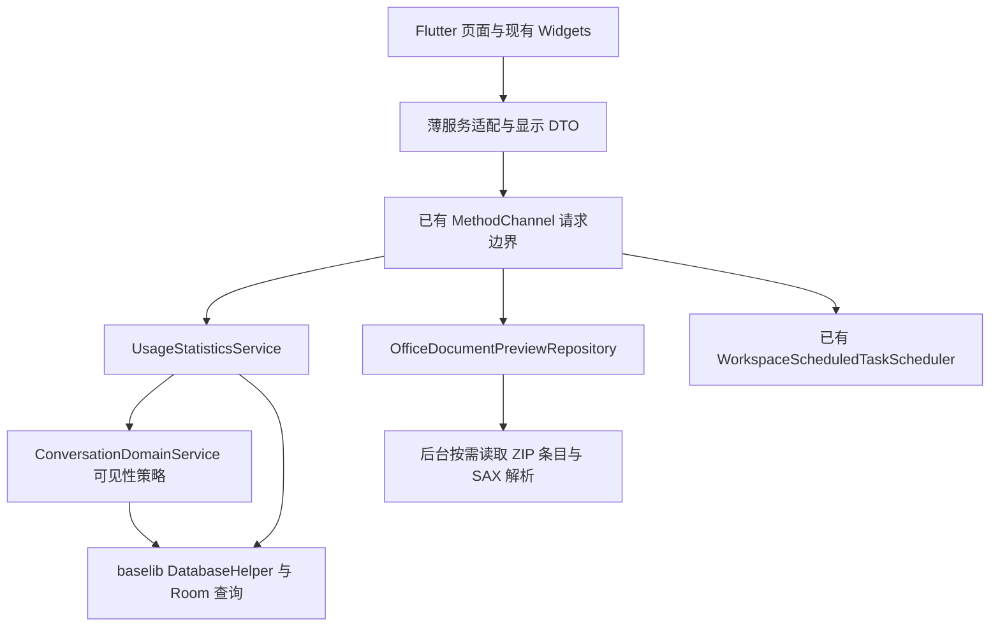

# Flutter 与 Kotlin 的职责边界

Flutter 保留视图、交互、动画、本地化和显示状态；Kotlin 管理 Android 数据访问、文件解析、统计聚合与原生任务调度。接口返回页面需要的显示数据，不要求页面先获取整库记录再计算结果。

## 数据职责

| 路径 | Kotlin 职责 | Flutter 职责 |
| --- | --- | --- |
| 会话活动图 | 有效会话轻量投影、隐藏与账户归属、按日计数和连续天数 | 原有日期范围构造、DTO 接收、热力图与动画 |
| Token 图 | Room 按周和模型分组、逐条 fallback 规则、模型 ID 归一、缓存合计和排序 | 周起点构造、显示 DTO、图例、tooltip 和格式化 |
| Office 预览 | 按需读取 ZIP 条目、完整解码单条目 XML、SAX 提取全部段落/表格/幻灯片 | 原有中英文案、完整显示 DTO、现有预览组件 |
| 定时任务 | 原生调度、重复规则、执行与 ACP 接入 | 提交已有 sync/upsert/delete 命令 |

本轮集中处理统计、Office、不可达旧实现和定时任务死分支，没有迁走全部 Dart 网络与缓存逻辑。`models_dev_catalog_service.dart` 的 HTTP 目录读取、ETag/TTL、内存与持久缓存仍在 Flutter，网络响应和缓存目录解析已通过 `compute` 执行；界面偏好、页面状态、本地化和显示 DTO 也继续由 Flutter 维护。`ChatConversationRuntimeCoordinator` 与唯一 `AgentEventReducer` 仍负责 ACP 消息身份、合并和显示投影。因此本轮结果是这些数据热路径下沉与职责收敛，不能称为全项目 Dart 已只剩纯布局。

Room 仍由 `baselib` 封装，`app` 不直接依赖 Room 实现类型。统计查询没有变更数据库 schema，没有复制标题、摘要或正文到统计 DTO。Na 会话沿用 `ConversationDomainService` 的隐藏与账户访问策略；原生和 Flutter 分别对异步读取期间的账户切换进行隔离。

统计图仍由 Flutter 按原 `DateTime`/`Duration` 规则给出范围与周起点。Kotlin 按相同 elapsed-time 边界计算，保留夏令时、完成 Token fallback、非正 Token 过滤、缓存独立累计和本周未来记录等原有语义。

Office 不以截断或减少显示内容换取速度。每个文件通道保留一个解析许可，多个内联文档排队解析；许可等待与 ZIP/XML 解析在原生后台执行。SAX 处理时仅暂存当前段落、行或共享字符串的节点结构，避免保留整个 XML DOM。

这并非字节流全程解析或常量内存方案：每个被读取的 ZIP 条目仍会完整读取、解码为 XML 字符串，并生成空白兼容处理所需的字符串；提取结果保留全部段落、表格行和幻灯片。完整结果仍经 MethodChannel 传给 Flutter，Dart 保留显示 DTO、本地化和渲染，因此通道编码、DTO 分配与界面绘制仍有成本。不能仅凭处理迁到后台或采用 SAX 就宣称峰值内存下降；内存结论需要独立测量。测试覆盖全部内容、顺序、稀疏列、特殊空白、UTF-8、XML 文本与实体兼容，以及排队取消后的后续请求。

## ACP 的现有边界

本轮数据重构不改变 `Conversation -> ACP Session -> Turn -> Item`。

- Conversation 持久化由 Room、`ConversationDomainService` 和 `AgentConversationHistoryRepository` 管理。
- ACP 传输和官方 session/prompt 生命周期仍由现有原生 runtime 管理。
- Flutter 的 `ChatConversationRuntimeCoordinator` 和唯一 `AgentEventReducer` 继续投影官方更新；它们包含身份归属、消息合并和显示状态，不能因为代码体积大而另起一个 reducer。
- 定时任务适配仅删除原生调度常量启用后不可达的 Dart Timer/执行分支，不引入另一条任务发起或终态路径。

## 维护与验证

新增数据处理先寻找现有 owner。复用已有服务与通道；将查询、完整文件解析、批量聚合留在 Kotlin 数据层，将颜色、文案、图形、布局和交互留在 Flutter。不能为了改变 GitHub 语言分类迁移视图，或把必要的 ACP 显示投影误删为冗余代码。

`scripts/audit-flutter-reachability.py` 可以检查入口断开的 Dart 文件。它是保守的文件依赖图，删除前仍需核对原生入口、条件导入、字符串引用、测试与 fixtures。有效回归测试应迁移到职责的新 owner；只删除失效实现的专属测试。

复用实机诊断流程见 [隔离性能探针](../scripts/performance/dart-kotlin-boundary/README.md)。其独立包、旧实现参照和合成数据只用于验证，正式入口仍为 `ui/lib/main_standard.dart`。
